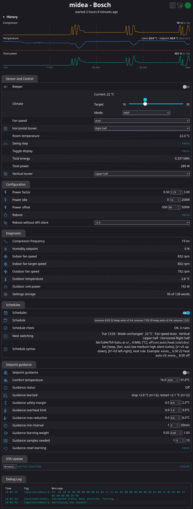
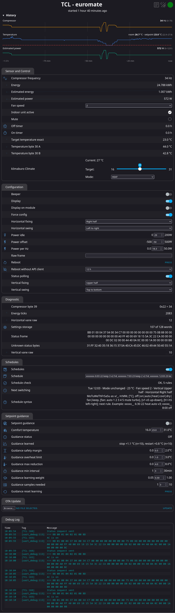
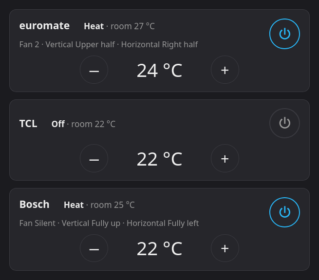

# esphome-local-ac-control

ESPHome firmware for TCL and Midea air conditioners (e.g. Midea Xtreme Save, Bosch Climate 4000i) that runs with or without Home Assistant: control through the built-in web interface and its REST API, schedules and a self-learning setpoint guidance on the device, a web interface that works without internet access. Home Assistant connects through the native API as usual.

<p>
	<a href="docs/bosch-midea.png"></a>
	<a href="docs/tcl-euromate.png"></a>
</p>

Example configurations:

| Configuration | Tested with | Module |
|---|---|---|
| `klima-tcl.yaml` | TCL TAC-09CHSD/XA71I (2.6 kW) and the identical Euromate 482255 | Tuya TYWE1S (ESP8266, 2 MB) on carrier board TYJW2 |
| `klima-bosch.yaml` | Bosch Climate 4000i (CL4000i 26 E, 2.6 kW), a Midea Xtreme Save (MSAGBU-09…) with Bosch badge | SMLIGHT SLWF-01Pro v2 |

For several units of the same type, copy the example, change `device_name` (TCL) or `name` (Bosch), `humanly_name` / `friendly_name` and the secret names.

TCL units use the component [tclac](https://github.com/I-am-nightingale/tclac), Midea units the component [juchong/esphome-midea](https://github.com/juchong/esphome-midea). `klima-tcl.yaml` takes tclac from the branch `localizable-options-and-log-typos` of the fork [E-t0m/tclac](https://github.com/E-t0m/tclac), which contains fixes that are not yet merged into tclac.

## Files

| File | Purpose |
|---|---|
| `schedule.yaml`, `schedule.h` | schedules as a text field, time via NTP, switch "Power" |
| `setpoint-guidance.yaml` | self-learning setpoint guidance for heating |
| `standalone.yaml` | select "Reboot without API client", button "Reboot" |
| `tcl-extra.yaml` | additional values from the TCL status frames (compressor frequency, estimated power, timers, energy, unknown bytes), select "Swing" |
| `tcl-protocol.yaml` | raw UART access for `tcl_probe.py` |
| `history.yaml`, `history.h` | history in RAM with growing interval (1 s up to 64 s, about 10.7 hours), shown as a chart in the web interface |
| `ui-extras.js` | extras for the web interface: power button, collapsible log, adjustable column width, lock while offline |
| `ac-panel.py`, `ac-panel.example.yaml` | web page on a Linux computer to switch all units on/off and set their temperature |
| `build-ui.py` | builds `esphome-ui.js`: web interface with icons and `ui-extras.js`, served from the device |
| `docs/flash-tcl-serial.md` | first flash of a TCL module over the serial port, backup of the original firmware |
| `klima-tcl-transition.yaml` | transition firmware that switches the flash layout of a TYWE1S via OTA |
| `tcl_probe.py`, `docs/tcl-probe.md` | investigate and control TCL units through the UART, by adapter or through the ESPHome module |
| `secrets.example.yaml` | template for `secrets.yaml` |

## Setup

```bash
python3 -m venv ~/venv/esphome
~/venv/esphome/bin/pip install esphome
cp secrets.example.yaml secrets.yaml
```

Tested with ESPHome 2026.6.5.

Fill in `secrets.yaml`. Quote every value, otherwise YAML may read a numeric password as a number. Keys and passwords:

```bash
openssl rand -base64 32
openssl rand -hex 12
```

Build the web interface, then compile and upload:

```bash
~/venv/esphome/bin/python build-ui.py klima-tcl.yaml klima-bosch.yaml
~/venv/esphome/bin/esphome run klima-bosch.yaml --device IP-OF-THE-MODULE
```

`build-ui.py` must run again after every ESPHome update and after adding icons to a configuration. On the first run it downloads the Iconify icon set "mdi" once (`.mdi.json`); afterwards no internet access is needed.

## Web interface without internet

ESPHome's web interface (version 3) loads its program and its icons from the internet. `build-ui.py` takes the interface of the installed ESPHome version, adds every icon used by the interface and by the configurations as `IconifyPreload`, appends `ui-extras.js` and writes `esphome-ui.js`. The configurations embed it with:

```yaml
web_server:
  version: 3
  js_url: ""
  js_include: esphome-ui.js
```

`ui-extras.js` adds:

- with the switch "Power" on the device (`schedule.yaml`), a power button at the very top left: off, or on with the last used mode
- a log icon at the top right that shows or hides the log column; collapsed by default
- a draggable divider to the right of the entities, double click resets the width
- all controls locked while the interface has no connection to the device
- the device name at the top reloads the page when clicked, e.g. after an update
- with `history.yaml` on the device, a history chart above the entities (see below); it fills the width and compresses as the history grows
- every section (and the history) folds with a click on its header; the browser remembers which ones are folded
- a line above the history with the operating state: mode, setpoint, room temperature, fan speed, vanes or swing
- − and + buttons next to the setpoint slider, one step of the unit each (1 °C on TCL, 0.5 °C on Midea); several clicks are sent together 0.6 s after the last one
- with `schedule.yaml` on the device, a resizable text field for the schedule with one rule per line, next to it the rules as the device understood them, the next switching point in bold

The browser remembers these settings per device.

## Schedules

The text field "Schedule" holds up to 10 rules, separated by `;` or a line break, 255 characters in total:

```
xxxxx__ 6:30 22 heat auto v3; xxxxx__ 8:00 off; _____xx 8:20 21 keep 2
```

| Part | Required | Values |
|---|---|---|
| days | yes | 7 characters Mon…Sun, `x` = on, `_` = off, or a single `X` = daily |
| time | yes | `6:30`, `06:30`, `20:05` |
| temperature | no | e.g. `22` or `21.5`, before the mode; missing = unchanged |
| mode | yes | `off`, `on` (last used mode), `auto`, `heat`, `cool`, `dry`, `fan`, `keep` (mode and on/off unchanged) |
| fan | no | first word after the mode, an option of the device's select "Fan speed" |
| vanes | no | `v1`–`v5` vertical (`v1` = fully up), `h1`–`h5` horizontal (`h1` = fully left) |
| display | no | `d0` display of the indoor unit off, `d1` on; with `keep` without changing anything else, e.g. `X 22:00 keep d0` |

- Each rule switches once at its minute. With several rules at the same minute the last one wins.
- With `keep` and the unit switched off only the target temperature is set.
- After a reboot the last switching point of the past 15 minutes is caught up, unless it was executed before the reboot.
- "Schedule check" shows `OK, n rules` or the first error, "Schedule syntax" a short guide with the fan words of the device.
- "Schedule rules" lists the rules one per line with their days and settings, e.g. `Mon–Fri 06:30 · Heat · 22 °C · Fan speed Auto`; the next one starts with `▶ `. In the web interface the list stands next to the text field.
- The switch "Schedules" turns all schedules on or off.
- The switch "Power" switches the unit off, or on again with the last used mode, like the rule mode `on`; setpoint, fan speed and vanes stay as the unit has them. It follows the unit, also when it is switched by remote control. `ui-extras.js` shows it as a power button at the very top left of the web interface, blue while the unit is on.
- At most 10 rules. They are stored packed rather than as text, because the settings storage of the ESP8266 holds only 512 bytes for all stored settings. After a reboot the text field shows the stored rules in the same format; rules with errors are not stored.

The time comes from NTP, by default from `pool.ntp.org`. With the substitution `ntp_server` set to the router (e.g. `fritz.box`) no internet access is needed while the router keeps its own clock. The substitution `timezone` sets the time zone, default `Europe/Berlin`.

## Setpoint guidance

Inverter units stop the compressor in heating mode once the room is warm enough. During these idle phases some units move the vanes to a rest position and blow little air. The setpoint guidance keeps the compressor at a low stage instead:

- **Learning:** at every compressor stop in heating mode the device records how far the room temperature was above the setpoint, likewise at every restart. Each becomes a moving average that survives reboots.
- **Guiding:** once enough stops are known and "Setpoint guidance" is on, the setpoint follows the room temperature just above the learned stop threshold, between "Comfort temperature" and "Comfort temperature" minus "Guidance max reduction".
- Below the comfort temperature, after a stop and above "Guidance overheat limit" the comfort temperature is used as setpoint.
- A setpoint changed by hand becomes the new comfort temperature. With guidance on, schedule temperatures set the comfort temperature.

All parameters are set in the web interface:

| Entity | Default | Meaning |
|---|---|---|
| Guidance safety margin | 0.5 °C | distance to the learned stop threshold |
| Guidance overheat limit | 1.0 °C | above comfort + limit an idle phase is allowed |
| Guidance max reduction | 4 °C | lowest setpoint = comfort − reduction |
| Guidance min interval | 3 min | minimum time between two reductions |
| Guidance learning weight | 0.3 | weight of a new measurement in the average |
| Guidance samples needed | 3 | stops before guidance acts |

"Guidance status" and "Guidance learned" show what the guidance does and has learned; learning runs while guidance is off as well. The compressor state comes from the compressor frequency of the Midea component or from the sensor "Compressor frequency" of `tcl-extra.yaml` (TCL, byte 39 of the status frame). TCL units accept the setpoint in whole degrees only.

## TCL: compressor frequency and estimated power

The climate card of the web interface shows no swing modes; the select "Swing" (`tcl-extra.yaml` on TCL units, `klima-bosch.yaml` on Midea units) switches swing off, vertical, horizontal or both and follows the unit, also when it is switched by remote control.

Byte 39 of the TCL status frame is the compressor frequency in Hz (0 = compressor stopped). `tcl-extra.yaml` shows it as "Compressor frequency" and, for comparison, as hex and decimal in "Compressor byte 39".

"Estimated power" calculates the electrical power of the whole unit from it:

| Frequency | Power |
|---|---|
| 0 Hz | "Power idle" |
| above 0 Hz | "Power offset" + "Power per Hz" × frequency |

The defaults (29 W, −50 W, 18.3 W/Hz) were measured on the Euromate 482255 (TCL TAC-09CHSD/XA71I) in heating mode with fan auto; they match the rating plate (heating 240–1552 W, 699 W rated), whose minimum of 240 W corresponds to about 16 Hz; single values deviate by about ±15 % depending on temperatures. The three values can be adjusted in the web interface. "Estimated energy" sums up the energy since the last boot.

## History

`history.yaml` keeps 600 samples (about 3.6 KB) in the RAM of the module, with a growing interval: it starts with one sample per second; whenever the buffer is full, neighbouring samples are averaged in pairs and the interval doubles, up to 64 s, which covers about 10.7 hours. Recorded values: compressor frequency, room temperature, setpoint (empty while the unit is off) and power (estimated power on the TCL units, total power on the Midea unit). The device serves it as `/history.json`; `ui-extras.js` shows it as three charts above the entities, so the curves are complete when the page is opened. The history starts empty after every reboot; writing it to flash would wear the flash out.

## Midea Xtreme Save / Bosch Climate 4000i

The Bosch Climate 4000i is built by Midea; it is the Midea Xtreme Save, model code MSAGBU, which Midea also sells as Xtreme Pro:

| Bosch | Midea | Capacity |
|---|---|---|
| CL4000i 26 E | Xtreme Save 9000 BTU/h (MSAGBU-09…) | 2.6 kW |
| CL4000i 35 E | Xtreme Save 12000 BTU/h (MSAGBU-12…) | 3.5 kW |
| CL4000i 53 E | Xtreme Save 18000 BTU/h (MSAGBU-18…) | 5.3 kW |

`klima-bosch.yaml` is tested with the CL4000i 26 E; the other sizes and other units of the Midea platform use the same protocol. The SLWF-01Pro v2 plugs into the unit with its USB-A plug and talks to it through the UART on GPIO12/GPIO14.

| Entity | Meaning |
|---|---|
| Climate | mode, setpoint (0.5 °C steps); Heat/Cool, Heat, Cool, Dry and Fan only are always offered, because the autoconf report of the 4000i does not always contain heating |
| Fan speed | select Auto, Low, Medium, High, Silent, Turbo, since the climate card of the web interface shows no fan modes; Silent and Turbo are declared in the configuration, the component does not take them from the capability report of the unit |
| Vertical louver, Horizontal louver | fixed vane position in five steps or "Last position"; the select shows the position reported by the unit |
| Louver restore delay | after switching on, the chosen positions are sent again after this time (default 15 s) and then every 30 s until the unit reports them, at most 10 times; while heating starts, the unit keeps the vanes in its own position for a while and ignores commands |
| Swing | Off, Vertical, Horizontal, Both; a swinging axis is left out when the fixed positions are sent again after switching on |
| Beeper, Display, Toggle display | beeper on/off, display of the indoor unit on/off; the unit only knows "toggle", so the switch "Display" remembers the state after its last command. After switching the display with the remote control, "Toggle display" brings switch and display in line again. |
| Compressor frequency, Outdoor unit power | from the diagnostic data of the unit |
| Indoor fan speed, Indoor fan target speed, Outdoor fan speed | fan speeds in rpm, so the current stage is visible in fan mode auto |
| Outdoor temperature, Room temperature | values reported by the unit |
| Total power, Total energy | estimated power of the whole unit, see below |

The vanes are set through the Midea properties 0x0009 (vertical) and 0x000A (horizontal) with command B0 and the values 1, 25, 50, 75, 100, like msmart does; property 0x001A (buzzer) is sent along and follows the switch "Beeper", otherwise the unit beeps.

The diagnostic values come from several data groups that the component queries in turn, one per `diagnostic_interval`. With 2 s each group is refreshed about every 10 s.

Schedules, setpoint guidance and history work as on the TCL units; the setpoint guidance uses 0.5 °C steps and the compressor frequency reported by the unit.

## Midea: total power

The Bosch Climate 4000i reports "Outdoor unit power", which covers only part of the consumption. `klima-bosch.yaml` estimates the power of the whole unit from it as "Total power":

| Compressor | Power |
|---|---|
| stopped | "Power idle" |
| running | "Power offset" + "Power factor" × outdoor unit power |

The defaults (12 W, 66 W, 1.13) were measured on the CL4000i 26 E in heating mode with fan auto and match a power meter within about 10 W at steady load. "Total energy" sums up the energy since the last boot.

## Panel for all units

`ac-panel.py` runs on a Linux computer in the home network and serves one page for all units: on/off and setpoint per unit, with mode, room temperature, fan speed and vanes; the name of a unit links to its own web interface. It keeps the event stream of each module open and sends the commands through their REST interface; the passwords of the modules stay on this computer. It needs Python 3 with PyYAML (`sudo apt install python3-yaml`) and the switch "Power" (`schedule.yaml`) on each module.

```bash
cp ac-panel.example.yaml ac-panel.yaml
python3 ac-panel.py
```



Enter the units in `ac-panel.yaml` (name, host name or IP, password from `secrets.yaml`) and open `http://COMPUTER:8080`. `panel_password` protects the page itself (user `admin`); without this line the page is open to everyone in the network. A setpoint changed with − and + is sent 0.8 s after the last click, in the step of the unit (1 °C on TCL, 0.5 °C on Midea).

As a service that starts with the computer, `~/.config/systemd/user/ac-panel.service`:

```ini
[Unit]
Description=Air conditioner panel
After=network-online.target

[Service]
WorkingDirectory=%h/github/esphome-local-ac-control
ExecStart=/usr/bin/python3 ac-panel.py
Restart=always
RestartSec=10

[Install]
WantedBy=default.target
```

```bash
systemctl --user daemon-reload
systemctl --user enable --now ac-panel
loginctl enable-linger $USER
journalctl --user -u ac-panel -f
```

`enable-linger` keeps the service running without a login.

## Running without Home Assistant

ESPHome reboots a device after 15 minutes without an API client. `standalone.yaml` replaces this with the select "Reboot without API client" (`Never`, `15 min` … `24 h`, default `Never`). A pending switching point postpones the reboot until it has been executed.

On the ESP8266, the diagnostic value "Settings storage" shows how much of the 128 words (512 bytes) for stored settings is in use. Settings that no longer fit are silently not stored, so it should stay below 128.

Control through REST, with digest authentication:

```bash
curl --digest -u admin:PASSWORD -X POST "http://klima-bosch.local/climate/Climate/set?mode=HEAT&target_temperature=23"
curl --digest -u admin:PASSWORD -X POST "http://klima-bosch.local/select/Fan%20speed/set?option=High"
curl --digest -u admin:PASSWORD -X POST "http://klima-bosch.local/text/Schedule/set?value=xxxxx__%206:30%20heat"
curl --digest -u admin:PASSWORD -X POST "http://klima-bosch.local/switch/Power/turn_off"
curl --digest -u admin:PASSWORD -X POST "http://klima-bosch.local/switch/Power/turn_on"
```

On the TCL units the climate entity is called `<device_name> Climate`, e.g. `/climate/klimatcl%20Climate/set`.

In a crontab every `%` must be written as `\%`.

## Flash layout of the TYWE1S

A module with the original Tuya firmware is flashed once over the serial port, see [docs/flash-tcl-serial.md](docs/flash-tcl-serial.md); afterwards all updates run over the air.

The TYWE1S has 2 MB flash. With the default layout only about 400 KB remain for an OTA update next to a firmware of this size. The TCL configurations use the layout `eagle.flash.2m64.ld` (64 KB file system, unused by ESPHome), which leaves almost 1 MB.

A module still running the default layout is switched in two OTA steps:

```bash
~/venv/esphome/bin/esphome compile klima-tcl-transition.yaml
grep ldscript .esphome/build/klimatcl/platformio.ini
~/venv/esphome/bin/esphome upload klima-tcl-transition.yaml --device IP
~/venv/esphome/bin/esphome run klima-tcl.yaml --device IP
```

The transition firmware only contains Wi-Fi and update and fits into the small free space. The stored settings of the device are empty once afterwards, because their flash sector moves with the layout.

## tcl_probe

`tcl_probe.py` investigates and controls TCL units through the UART of the Wi-Fi module socket, by USB UART adapter or through the installed ESPHome module: protocol, wiring, sniffing, polling, setting values, raw frames. See [docs/tcl-probe.md](docs/tcl-probe.md).

## License

MIT, see `LICENSE`. The components tclac and juchong/esphome-midea are included from their own repositories and keep their own licenses.
